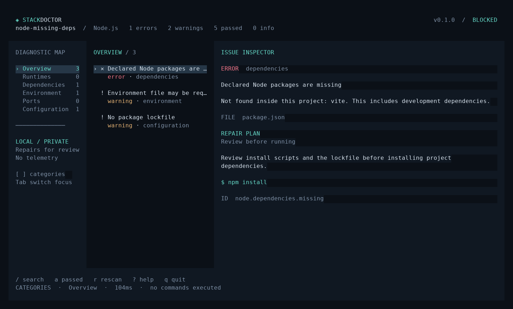

# StackDoctor

**Cloned a project. Can't run it. Find the blocker.**

[](https://github.com/MMH-4ALL/StackDoctor/actions/workflows/ci.yml)
[](https://github.com/MMH-4ALL/StackDoctor/releases/latest)
[](LICENSE)

StackDoctor is a local development environment diagnostic tool for **Node.js, Python, Go, and Rust**. It checks the selected project, explains detected problems, and shows repair commands for you to review. A full-screen dashboard and scriptable CLI use the same detector engine.

No accounts. No paid APIs. No telemetry. No automatic repairs.



This screenshot comes from the running `v0.1.0` application against [the included example](examples/node-missing-deps). It shows real findings. An authentic terminal recording is available at [docs/demo.cast](docs/demo.cast); replay it with `asciinema play docs/demo.cast`.

## Install

Download an archive for your system from [Releases](https://github.com/MMH-4ALL/StackDoctor/releases/latest). Linux and Windows binaries are available for x86-64 (`amd64`) and ARM64. They do not require Go, Python, or Node to run StackDoctor itself.

### Linux, x86-64

Download `stackdoctor_0.1.0_linux_amd64.tar.gz` and `checksums.txt` from the release, then:

```bash
sha256sum --ignore-missing -c checksums.txt
tar -xzf stackdoctor_0.1.0_linux_amd64.tar.gz
mkdir -p "$HOME/.local/bin"
install -m 755 stackdoctor "$HOME/.local/bin/stackdoctor"
stackdoctor --version
```

Ensure `$HOME/.local/bin` is on your `PATH`. ARM64 users should select the `linux_arm64` archive.

### Windows, PowerShell

Download `stackdoctor_0.1.0_windows_amd64.zip` and `checksums.txt`. Check the ZIP's SHA-256 against the matching line in `checksums.txt`, then extract it:

```powershell
Get-FileHash .\stackdoctor_0.1.0_windows_amd64.zip -Algorithm SHA256
Expand-Archive .\stackdoctor_0.1.0_windows_amd64.zip -DestinationPath .\StackDoctor
.\StackDoctor\stackdoctor.exe --version
```

Put `stackdoctor.exe` in a folder on your user `PATH`, or use its full path. Windows Terminal is recommended for the dashboard. ARM64 users should select the `windows_arm64` archive. Checksums detect download corruption; they are not a code-signing certificate.

### Build from source

Go **1.24 or later** is required to build; it is not required to run a release binary.

```bash
git clone https://github.com/MMH-4ALL/StackDoctor.git
cd StackDoctor
go build -trimpath -ldflags="-s -w -X main.version=0.1.0" -o stackdoctor ./cmd/stackdoctor
./stackdoctor --help
```

On Windows, use `-o stackdoctor.exe` and run `.\stackdoctor.exe`.

Or install the tagged source with Go:

```bash
go install github.com/MMH-4ALL/StackDoctor/cmd/stackdoctor@v0.1.0
```

The binary is installed in Go's configured binary directory. `go install` uses the default `dev` version label; official release archives embed `0.1.0`.

## Use

```bash
stackdoctor check
stackdoctor doctor
stackdoctor check ./my-project --port 3000
stackdoctor check --path ./my-project --no-ports --format json
stackdoctor explain node.dependencies.missing --path ./my-project
stackdoctor report ./my-project --format json --output diagnosis.json
stackdoctor report ./my-project --format markdown --output diagnosis.md
stackdoctor --help
```

Without a command, StackDoctor opens the dashboard in an interactive terminal and prints a check in a non-interactive session. Select a project with `--path` or a positional directory. Flags may come before or after the directory.

`explain` rescans the current project and explains its current findings. Give a finding ID from `check` for one explanation; use `--path` to select the directory. It does not load or execute a stored repair plan.

Files created by `--output` use restrictive permissions on systems that support them. Existing files are **never overwritten**. Reports omit the absolute project path and include only its directory name.

| Command | Purpose | Exit status |
| --- | --- | --- |
| `check` | Print diagnostics; supports text, JSON, Markdown | `0` without errors; `1` with detected errors |
| `check --strict` | Also fail on warnings | `1` with errors or warnings |
| `doctor` | Interactive dashboard | `0` on normal quit |
| `explain` | Explain current findings and suggestions | `0` on success |
| `report` | Export diagnostics, even when problems exist | `0` when export succeeds |
| All commands | Invalid input, unavailable path, timeout, write failure | `2` |

For CI, use `check --format json`; it returns failure when it finds a blocker. `report` deliberately succeeds when it has exported a valid report containing errors.

### Dashboard controls

| Key | Action |
| --- | --- |
| `Tab` | Switch between categories and findings |
| `↑` / `↓`, `j` / `k` | Move through the focused panel |
| `[` / `]`, left / right | Change category |
| `Enter` | Open or close the issue viewer on smaller terminals |
| `/` | Search finding titles, IDs, and details |
| `Esc` | Clear search or close the viewer/help |
| `a` | Show or hide passed checks |
| `PageUp` / `PageDown`, `Ctrl+U` / `Ctrl+D` | Scroll the selected explanation |
| `r` | Run a fresh scan |
| `?` | Show help |
| `q`, `Ctrl+C` | Quit |

Wide terminals show categories, findings, and the issue inspector together. Medium terminals use a separate issue view; small terminals retain a usable findings view. The minimum dashboard size is 35 columns by 12 rows. Text, JSON, and Markdown work without an interactive terminal.

## What v0.1.0 checks

| Area | Checks |
| --- | --- |
| Node.js | `package.json`, runtime availability, `engines.node`, numeric `.nvmrc`/`.node-version`, declared package manager and version, conflicting/missing lockfiles, npm lockfile syntax/version, presence of direct and development package manifests in local `node_modules` |
| Python | Python availability, `requires-python`, numeric `.python-version`, common requirement rules, missing/mismatched local `.dist-info` packages, local `.venv`/`venv`, `pyproject.toml`/`Pipfile` syntax, availability of uv/Poetry/Pipenv when their files are present |
| Go | Go availability, minimum/toolchain version, `go.mod`/`go.work` syntax, missing in-project local replacements and workspace directories, external-path notices, missing checksum/vendor metadata |
| Rust | rustc/Cargo availability, minimum/compiler edition requirements, numeric toolchain pins, `Cargo.toml`/`Cargo.lock` syntax, missing in-project path dependencies, external-path notices, missing lockfile |
| Environment | `.env.example`, `.env.sample`, `.env.template`, and variants such as `.env.local.example`; likely target file names and missing key names |
| Ports | Explicit `--port` values, numeric `PORT` in `.env`/`.env.local`, common Node start/dev port flags, Vite/Next/React Scripts/Astro/Nuxt defaults; IPv4/IPv6 loopback TCP listeners |

`blocked` means at least one error; `needs attention` means warnings; `clear` means no blockers were detected; `unknown` means no supported stack was detected. These states come from check counts. **Clear does not guarantee startup.** Informational findings explain checks that could not establish availability.

## Privacy and scan boundaries

- Reads are confined to the selected directory through Go's traversal-resistant `os.Root` API. There is no recursive project discovery or parent-directory scan.
- Each file is capped at 2 MiB, directory lists at 4,096 entries, environment templates at 16, and ports at 16. Special files and final-component symbolic links are rejected; intermediate links cannot escape the project.
- Environment values, raw parser errors, raw runtime output, scripts, dependency URLs, and the absolute project path are not put in reports. Key names and a strictly numeric `PORT` may be reported.
- Runtime tools receive only fixed version probes. Project-local executables are rejected. Probes have a three-second timeout and limited output; Go/Corepack/Rustup automatic toolchain/network behavior is disabled where supported.
- The scan never runs package installs, Python imports, project commands, shell repair commands, `build.rs`, or downloaded plugins/scripts. Trusted runtime executables found outside the project are still programs; StackDoctor is not an operating-system sandbox for a malicious global tool.
- Port checks make brief loopback TCP connections. Disable them with `--no-ports`. No remote hosts, process command lines, or process termination are used.

See [SECURITY.md](SECURITY.md) for the threat model and private reporting process.

## Current limits

- A scan covers one selected project root. Monorepo/workspace members must be selected individually.
- Go and Rust global caches and registry downloads are not inspected. Their dependency **availability is unverified**; local path and lockfile problems are still checked.
- Node package checks establish presence, not installed version or transitive integrity. Yarn PnP is recognized but not executed. Package-manager `.cmd`/`.bat` wrappers on Windows are recognized without version execution, so their versions may be unverified.
- Python supports a common subset of PEP 440 and plain requirements. Conditional markers, direct URLs, nested requirement files, complex Poetry specifications, legacy setup declarations, optional dependency groups, Conda, and external environments are not fully evaluated. Local metadata does not prove importability.
- Numeric pins are checked offline. Moving aliases such as `lts/*`, `stable`, and `nightly` require manual review.
- Environment templates can contain optional keys. Template-derived warnings are clues, not proof that every key is required. Values are not validated.
- Port results are point-in-time loopback TCP checks. They do not prove a process will be able to bind, cover UDP/non-loopback-only listeners, or identify the owning process.
- This is an initial release with an intentionally bounded detector set. It does not run the project to diagnose application logic, native libraries, databases, or Docker services.

## Contribute

Want to add a framework check? Start with the public [detector contract](pkg/diagnostic/engine.go), [architecture guide](docs/ARCHITECTURE.md), and [CONTRIBUTING.md](CONTRIBUTING.md). Detectors are compiled in and explicitly registered; no executable plugin downloads are needed.

Small contribution ideas and acceptance criteria are in [docs/GOOD_FIRST_ISSUES.md](docs/GOOD_FIRST_ISSUES.md) and the [good first issue tracker](https://github.com/MMH-4ALL/StackDoctor/labels/good%20first%20issue).

```bash
go test ./...
go test -race ./...
go vet ./...
```

CI runs native tests on Linux and Windows, checks formatting and vet, and cross-compiles the four release targets. Tagged releases run tests before publishing archives and SHA-256 checksums. Release packaging can also be run with `python3 scripts/package.py 0.1.0` (maintainer tooling only).

Made by [MMH-4ALL](https://github.com/MMH-4ALL). Released under the [MIT license](LICENSE). Dependencies retain their own terms in [THIRD_PARTY_NOTICES.md](THIRD_PARTY_NOTICES.md).
